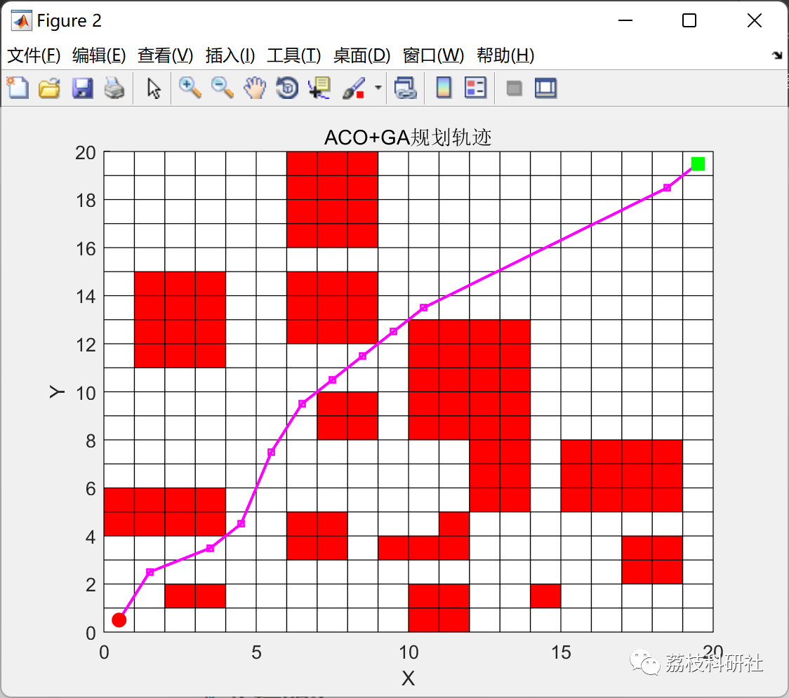
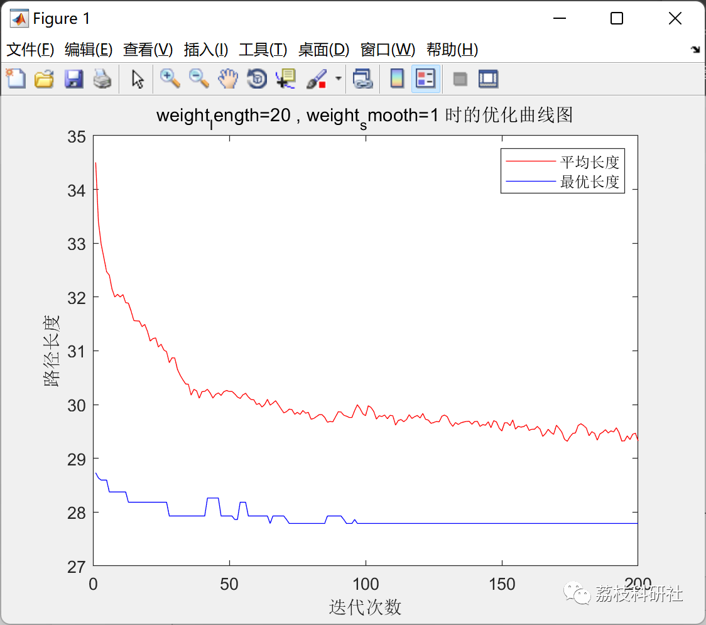

# Path Planning Problem Based on Ant-Genetic Algorithm (Matlab Code Implementation)

💥💥💥💞💞💞💞 Welcome to this blog❤️❤️❤️💥💥💥
🏆 Bloggers' Advantage: 🌞🌞🌞 The content of the blog strives to be rigorous in thought and clear in logic, for the convenience of readers.
⛳️ Mantra: The journey of a hundred miles is half done in the last ninety.
Litchi Research Society
Code Collection: Power System, Intelligent Algorithms and Applications, Neural Network Prediction, Path Planning, Optimized Scheduling, Workshop Scheduling, Image Processing, Signal Processing...
🎁Column Directory Link:
🌈🌈🌈🌟🌟🌟🛫🛫🛫🛫🛫🛫🛫🛫🛫🛫🛫🛫🛫🛫🛫🛫🛫🛫🛫🛫🛫🛫🛫🛫🛫🛫🛫🛫🛫🛫🛫🛫🛫🛫🛫🛫🛫🛫🛫🛫🛫🛫🛫🛫🛫🛫🛫🛫🛫🛫🛫🛫🛫🛫🛫🛫🛫🛫🛫🛫🛫🛫🛫🛫🛫🛫🛫🛫🛫🛫🛫🛫🛫🛫🛫🛫🛫🛫🛫🛫🛫🛫🛫🛫🛫🛫🛫🛫🛫🛫🛫🛫🛫🛫🛫🛫🛫🛫🛫🛫🛫🛫🛫🛫🛫🛫🛫🛫🛫🛫🛫🛫🛫🛫🛫🛫🛫🛫🛫🛫🛫🛫🛫🛫🛫🛫🛫🛫🛫🛫🛫🛫🛫🛫🛫🛫🛫🛫🛫🛫🛫🛫🛫🛫🛫🛫🛫🛫🛫🛫🛫🛫🛫🛫🛫🛫🛫🛫🛫🛫🛫🛫🛫🛫🛫🛫🛫🛫🛫🛫🛫🛫🛫🛫🛫🛫🛫🛫🛫🛫🛫🛫🛫🛫🛫🛫🛫🛫🛫🛫🛫🛫🛫🛫🛫🛫🛫🛫🛫🛫🛫🛫🛫🛫🛫🛫🛫🛫🛫🛫🛫🛫🛫🛫🛫🛫🛫🛫🛫🛫🛫🛫🛫🛫🛫🛫🛫🛫🛫🛫🛫🛫🛫🛫🛫🛫🛫🛫🛫🛫🛫🛫🛫🛫🛫🛫🛫🛫🛫🛫🛫🛫🛫🛫🛫🛫
​  
💥1 Overview
Mobile robot path planning technology refers to the robot's own sensors perceiving the surrounding environment, then autonomously planning a safe and efficient operational path while accomplishing the corresponding tasks. Currently, common algorithms for mobile robot path planning include artificial potential field methods, RRT (Rapidly-exploring Random Tree) algorithms, A* (A-star) algorithms, Q learning methods, and other biomimetic algorithms such as particle swarm optimization, genetic algorithms, and ant colony algorithms. These algorithms have demonstrated excellent performance in the field of robot path planning, but they also face issues. For instance, when planning paths, most focus on the length of the path while neglecting other factors, which still poses significant challenges in practical application scenarios. In actual work with mobile robots, not only do we strive for the shortest possible path but also demand high levels of turn-around times and changes in height. If we solely consider the distance traveled as the sole criterion, it may lead to an increase in the number of turns and climbs, which not only increases operational costs but could also harm the robot's lifespan. Therefore, exploring the best path planning algorithm that takes into account comprehensive indicators has become a hot topic in the field of mobile robotics.
📚2 Running Results
🎉3 References
[1] Gu Xingsu. Research on Robot Path Planning Based on Improved PSO-ACO Algorithm [D]. Northeast Petroleum University, 2020. DOI: 10.26995/d.cnki.gdqsc.2020.000123.
[2] Xu Lunhui, Zeng Yuhao. Path Planning Based on Improved ACO and Cubic B-Spline Curves [J]. Computer Simulation, 2022, 39(07):407-411.
👨‍💻4 Matlab Code
Click the left bottom corner of the article to read the full text.

## Images

<!-- PAYMENT_BLOCK -->

## Get this dataset

- Payment link (Stripe): [Buy now](https://buy.stripe.com/3cs8yP7sY87d0vu9AB)
- Payment QR code: 

<!-- /PAYMENT_BLOCK -->
